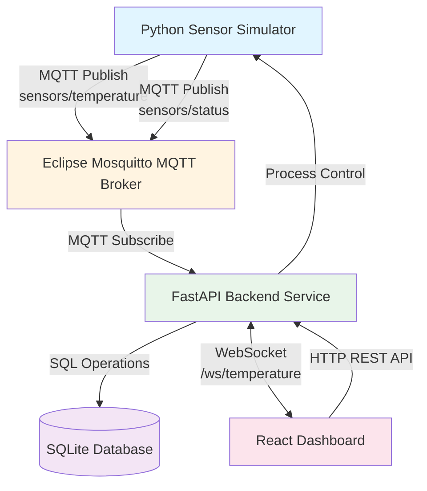

# Design Document: ThermosenseIoT Dashboard

## Overview

The ThermosenseIoT Dashboard is a real-time temperature monitoring system demonstrating IoT communication patterns using MQTT protocol. The system architecture follows a publisher-subscriber pattern with four main components: a Python sensor simulator (publisher), an Eclipse Mosquitto MQTT broker (message router), a FastAPI backend service (subscriber and data processor), and a React web dashboard (visualization layer).

### System Architecture

The system employs a layered architecture with clear separation of concerns:

1. **Data Generation Layer**: Python sensor simulator generates temperature readings
2. **Message Transport Layer**: MQTT broker routes messages between publishers and subscribers
3. **Processing and Persistence Layer**: FastAPI backend subscribes to MQTT topics, validates and persists data, and provides HTTP/WebSocket APIs
4. **Presentation Layer**: React dashboard consumes APIs and displays real-time visualizations



### Technology Stack

- **Frontend**: React.js 18+ with Vite build tool, JavaScript (no TypeScript), vanilla CSS (no Tailwind), Recharts for charting, Lucide React for icons
- **Backend**: Python 3.11+, FastAPI web framework, Uvicorn ASGI server, Paho MQTT client library, SQLite database, Pydantic for data validation
- **Message Broker**: Eclipse Mosquitto 2.x, MQTT protocol version 3.1.1
- **Deployment**: Local development environment, Windows PowerShell for process management

### Design Principles

1. **Asynchronous Communication**: Use MQTT pub/sub and WebSockets for decoupled, real-time data flow
2. **Data Validation**: Validate all inputs at API boundaries using Pydantic models
3. **Resilience**: Implement automatic reconnection logic for all network connections
4. **Performance**: Cap data retention and visualization points to prevent memory issues
5. **Separation of Concerns**: Clear boundaries between transport, business logic, persistence, and presentation layers

---

## Architecture

### Component Interaction Flow

**Normal Operation Flow**:
1. Sensor simulator publishes temperature reading to `sensors/temperature` topic every 2 seconds
2. MQTT broker receives message and forwards to backend subscriber
3. Backend validates message, persists to database, checks threshold
4. If threshold exceeded, backend creates alert event and persists it
5. Backend broadcasts temperature reading and/or alert to all connected WebSocket clients
6. Dashboard receives WebSocket message and updates UI (live value, chart, alerts panel)

**Control Flow**:
1. User clicks "Start Simulator" button in dashboard
2. Dashboard sends POST request to `/api/simulator/start`
3. Backend spawns Python simulator process
4. Backend returns success response
5. Simulator begins publishing messages (enters normal operation flow)

**Query Flow**:
1. User selects time window ("5 min", "15 min", etc.) in dashboard
2. Dashboard sends GET request to `/api/readings/history?start_time=X&end_time=Y`
3. Backend queries database with time range filter
4. Backend returns JSON array of temperature readings
5. Dashboard renders historical data on chart

### Network Communication Protocols

**MQTT Protocol**:
- Protocol version: 3.1.1
- Transport: TCP on port 1883 (unencrypted, localhost only)
- QoS level 1 (at least once delivery) for temperature readings
- Topic hierarchy: `sensors/{metric_type}` (e.g., `sensors/temperature`, `sensors/status`)
- Message format: JSON payloads with UTF-8 encoding
- Keep-alive: 60 seconds (MQTT default)

**WebSocket Protocol**:
- Endpoint: `ws://localhost:8000/ws/temperature`
- Message format: JSON text frames
- No authentication (local development environment)
- Bidirectional capability (though current design only uses server-to-client)
- No ping/pong required (FastAPI handles this automatically)

**HTTP/REST Protocol**:
- Base URL: `http://localhost:8000`
- Content-Type: `application/json` for request/response bodies
- Standard HTTP methods: GET for queries, POST for commands, PUT for updates
- Status codes: 200 (success), 400 (validation error), 500 (server error), 503 (service unavailable)

### Concurrency Model

**Backend Concurrency**:
- FastAPI runs on Uvicorn ASGI server with single-process asyncio event loop
- MQTT client runs in separate thread with `loop_start()` to avoid blocking the asyncio loop
- WebSocket connections handled as async coroutines (each connection is a coroutine task)
- Database operations use synchronous SQLite with connection pooling (SQLite is thread-safe in serialized mode)
- Maximum concurrent WebSocket connections: 10 (per requirements)

**Frontend Concurrency**:
- Single-threaded JavaScript event loop
- WebSocket messages processed via event handlers
- React state updates batched by React 18 automatic batching
- No Web Workers used (complexity not justified for this scale)

### Error Propagation Strategy

**MQTT Layer Errors**:
- Connection failures: Trigger automatic reconnection with exponential backoff
- Invalid message format: Log error, discard message, continue processing queue
- QoS failures: Paho MQTT client retries automatically (QoS 1)

**Backend Layer Errors**:
- Database errors: Return HTTP 503, log error with stack trace, continue serving other requests
- Validation errors: Return HTTP 400 with descriptive error message
- Simulator control errors: Return HTTP 500 with error details
- WebSocket errors: Close faulty connection, continue serving other clients

**Frontend Layer Errors**:
- WebSocket connection loss: Display "disconnected" indicator, retry every 3 seconds
- HTTP request failures: Display error toast, provide retry button
- Chart rendering errors: Boundary error component displays fallback message


## Components and Interfaces

### Python MQTT Sensor Simulator

**Responsibility**: Generate simulated temperature readings and publish via MQTT.

**Configuration**:
```json
{
  "sensor": {
    "device_id": "sensor-001",
    "publish_interval": 2.0,
    "temperature_min": 20.0,
    "temperature_max": 32.0,
    "mqtt_broker_host": "localhost",
    "mqtt_broker_port": 1883
  }
}
```

**Core Logic**:
```python
class TemperatureSensor:
    def __init__(self, config):
        self.device_id = config["device_id"]
        self.interval = config["publish_interval"]
        self.temp_range = (config["temperature_min"], config["temperature_max"])
        self.client = mqtt.Client(client_id=self.device_id)
        self.running = False
        self.spike_requested = False
        
    def connect(self):
        self.client.on_connect = self._on_connect
        self.client.on_disconnect = self._on_disconnect
        self.client.connect(host, port, keepalive=60)
        self.client.loop_start()  # Non-blocking background thread
        
    def _on_connect(self, client, userdata, flags, rc):
        if rc == 0:
            logger.info(f"Connected to MQTT broker")
        else:
            logger.error(f"Connection failed with code {rc}")
            
    def _on_disconnect(self, client, userdata, rc):
        if rc != 0:
            logger.warning(f"Unexpected disconnect, reconnecting...")
            # Paho MQTT client will auto-reconnect with loop_start()
            
    def run(self):
        self.running = True
        while self.running:
            if self.spike_requested:
                temp = self._generate_spike_temperature()
                self.spike_requested = False
            else:
                temp = random.uniform(*self.temp_range)
                
            reading = {
                "device_id": self.device_id,
                "temperature": round(temp, 2),
                "unit": "C",
                "timestamp": datetime.utcnow().isoformat() + "Z"
            }
            
            result = self.client.publish(
                "sensors/temperature",
                json.dumps(reading),
                qos=1
            )
            
            if result.rc != mqtt.MQTT_ERR_SUCCESS:
                logger.error(f"Publish failed: {result.rc}")
                
            time.sleep(self.interval)
            
    def stop(self):
        self.running = False
        status_msg = {
            "device_id": self.device_id,
            "status": "offline",
            "timestamp": datetime.utcnow().isoformat() + "Z"
        }
        self.client.publish("sensors/status", json.dumps(status_msg), qos=1)
        self.client.loop_stop()
        self.client.disconnect()
```

**Reconnection Strategy**:
- Use `client.loop_start()` which runs MQTT network loop in background thread with automatic reconnection
- Implement `on_disconnect` callback to log reconnection attempts
- Paho MQTT client handles exponential backoff automatically when using `loop_start()`
- Maximum reconnection attempts: infinite (will reconnect whenever broker becomes available)

**Spike Simulation**:
- Check for spike signal file (e.g., `/tmp/thermosense_spike_signal.txt`) on each iteration
- If file exists, read threshold value, generate temperature = threshold + 5.0 + random(0, 2)
- Delete signal file after reading
- Publish spike temperature reading, then resume normal generation

**Interface**:
- Input: Configuration from config.json
- Output: MQTT messages published to `sensors/temperature` and `sensors/status` topics
- Control: Signal file for spike generation, SIGTERM/SIGINT for graceful shutdown

---

### Eclipse Mosquitto MQTT Broker

**Responsibility**: Route MQTT messages between publishers (simulator) and subscribers (backend).

**Configuration File** (`mosquitto.conf`):
```conf
# Listen on all interfaces, port 1883
listener 1883 0.0.0.0

# Allow anonymous connections (no authentication)
allow_anonymous true

# Retain last status message
retain_available true

# Log to console for development
log_dest stdout
log_type all

# MQTT protocol version 3.1.1
protocol_version mqttv311

# Connection settings
max_connections -1
max_keepalive 300
```

**Startup Command**:
```powershell
mosquitto -c mosquitto.conf -v
```

**Topic Design**:
- `sensors/temperature`: Real-time temperature readings (not retained)
- `sensors/status`: Sensor online/offline status (retained, so new subscribers get last known status)

**Security Considerations**:
- No authentication required (local development environment)
- Bind to localhost only in production deployments
- Consider TLS and username/password for non-local deployments (out of scope for current requirements)

**Interface**:
- Input: MQTT CONNECT, PUBLISH, SUBSCRIBE messages on port 1883
- Output: Routed MQTT messages to subscribers
- Monitoring: Log messages to stdout


### FastAPI Backend Service

**Responsibility**: Subscribe to MQTT messages, persist data, enforce business rules, provide HTTP/WebSocket APIs.

#### MQTT Client Component

**Implementation**:
```python
class MQTTClient:
    def __init__(self, config, db_manager, websocket_manager):
        self.config = config
        self.db = db_manager
        self.ws_manager = websocket_manager
        self.client = mqtt.Client(client_id="backend-service")
        self.connected = False
        self.threshold = config["default_threshold"]
        
    def connect(self):
        self.client.on_connect = self._on_connect
        self.client.on_disconnect = self._on_disconnect
        self.client.on_message = self._on_message
        
        self.client.connect(
            self.config["mqtt_broker_host"],
            self.config["mqtt_broker_port"],
            keepalive=60
        )
        
        # Run MQTT loop in separate thread to avoid blocking FastAPI
        self.client.loop_start()
        
    def _on_connect(self, client, userdata, flags, rc):
        if rc == 0:
            self.connected = True
            logger.info("Backend connected to MQTT broker")
            # Re-subscribe on reconnection
            client.subscribe("sensors/temperature", qos=1)
            client.subscribe("sensors/status", qos=1)
        else:
            logger.error(f"MQTT connection failed: {rc}")
            
    def _on_disconnect(self, client, userdata, rc):
        self.connected = False
        if rc != 0:
            logger.warning(f"Unexpected MQTT disconnect: {rc}, will auto-reconnect")
            # loop_start() handles reconnection automatically
            
    def _on_message(self, client, userdata, msg):
        try:
            payload = json.loads(msg.payload.decode('utf-8'))
            
            if msg.topic == "sensors/temperature":
                self._handle_temperature_reading(payload)
            elif msg.topic == "sensors/status":
                self._handle_status_message(payload)
                
        except json.JSONDecodeError:
            logger.error(f"Invalid JSON from {msg.topic}: {msg.payload}")
        except Exception as e:
            logger.error(f"Error processing message: {e}", exc_info=True)
            
    def _handle_temperature_reading(self, payload):
        # Validate message structure
        try:
            reading = TemperatureReading(**payload)
        except ValidationError as e:
            logger.error(f"Validation failed: {e}")
            return
            
        # Persist to database
        self.db.insert_reading(reading)
        
        # Check threshold and create alert if needed
        if reading.temperature > self.threshold:
            alert = self._create_alert(reading)
            self.db.insert_alert(alert)
            # Broadcast alert to WebSocket clients
            asyncio.run_coroutine_threadsafe(
                self.ws_manager.broadcast_alert(alert),
                self.ws_manager.loop
            )
        else:
            # Mark any existing alerts as resolved
            self.db.resolve_alerts(reading.device_id)
            
        # Broadcast reading to WebSocket clients
        asyncio.run_coroutine_threadsafe(
            self.ws_manager.broadcast_reading(reading),
            self.ws_manager.loop
        )
        
    def disconnect(self):
        self.client.loop_stop()
        self.client.disconnect()
```

**Thread Safety**:
- MQTT client runs in separate thread via `loop_start()`
- Use `asyncio.run_coroutine_threadsafe()` to bridge thread-based MQTT callbacks with asyncio WebSocket manager
- Pass reference to asyncio event loop during initialization


#### WebSocket Manager Component

**Implementation**:
```python
class WebSocketManager:
    def __init__(self):
        self.active_connections: Set[WebSocket] = set()
        self.loop = None  # Set to asyncio event loop on startup
        
    async def connect(self, websocket: WebSocket):
        await websocket.accept()
        self.active_connections.add(websocket)
        logger.info(f"WebSocket connected. Total: {len(self.active_connections)}")
        
    def disconnect(self, websocket: WebSocket):
        self.active_connections.discard(websocket)
        logger.info(f"WebSocket disconnected. Total: {len(self.active_connections)}")
        
    async def broadcast_reading(self, reading: TemperatureReading):
        message = {
            "type": "temperature",
            "data": reading.dict()
        }
        await self._broadcast(message)
        
    async def broadcast_alert(self, alert: AlertEvent):
        message = {
            "type": "alert",
            "data": alert.dict()
        }
        await self._broadcast(message)
        
    async def _broadcast(self, message: dict):
        if not self.active_connections:
            return
            
        message_json = json.dumps(message)
        disconnected = set()
        
        for connection in self.active_connections:
            try:
                await connection.send_text(message_json)
            except Exception as e:
                logger.error(f"Error sending to WebSocket: {e}")
                disconnected.add(connection)
                
        # Clean up disconnected clients
        for conn in disconnected:
            self.active_connections.discard(conn)
```

**WebSocket Endpoint**:
```python
@app.websocket("/ws/temperature")
async def websocket_endpoint(websocket: WebSocket):
    await ws_manager.connect(websocket)
    try:
        # Keep connection alive, listen for any client messages
        while True:
            # Wait for client message (or disconnect)
            data = await websocket.receive_text()
            # Current design doesn't process client messages
            # This loop just keeps connection alive
    except WebSocketDisconnect:
        ws_manager.disconnect(websocket)
```

**Scalability Considerations**:
- Current design supports up to 10 concurrent WebSocket connections (per requirements)
- For scaling beyond 10 connections, consider: Redis pub/sub for multi-worker broadcasting, connection pooling, rate limiting
- Single Uvicorn worker is sufficient for current requirements


#### Database Layer Component

**Schema**:
```sql
CREATE TABLE IF NOT EXISTS temperature_readings (
    id INTEGER PRIMARY KEY AUTOINCREMENT,
    device_id TEXT NOT NULL,
    temperature REAL NOT NULL,
    unit TEXT NOT NULL,
    timestamp TEXT NOT NULL
);

CREATE INDEX IF NOT EXISTS idx_timestamp ON temperature_readings(timestamp);
CREATE INDEX IF NOT EXISTS idx_device_timestamp ON temperature_readings(device_id, timestamp);

CREATE TABLE IF NOT EXISTS alert_events (
    id INTEGER PRIMARY KEY AUTOINCREMENT,
    device_id TEXT NOT NULL,
    temperature REAL NOT NULL,
    threshold REAL NOT NULL,
    alert_type TEXT NOT NULL,
    timestamp TEXT NOT NULL,
    resolved BOOLEAN NOT NULL DEFAULT 0
);

CREATE INDEX IF NOT EXISTS idx_alert_timestamp ON alert_events(timestamp);
CREATE INDEX IF NOT EXISTS idx_alert_resolved ON alert_events(resolved);
CREATE INDEX IF NOT EXISTS idx_alert_device_resolved ON alert_events(device_id, resolved);
```

**Database Manager**:
```python
class DatabaseManager:
    def __init__(self, db_path: str):
        self.db_path = db_path
        self.connection = None
        self._initialize_db()
        
    def _initialize_db(self):
        self.connection = sqlite3.connect(self.db_path, check_same_thread=False)
        self.connection.row_factory = sqlite3.Row
        cursor = self.connection.cursor()
        
        # Execute CREATE TABLE statements
        cursor.executescript(SCHEMA_SQL)
        self.connection.commit()
        
    def insert_reading(self, reading: TemperatureReading):
        cursor = self.connection.cursor()
        cursor.execute(
            """
            INSERT INTO temperature_readings (device_id, temperature, unit, timestamp)
            VALUES (?, ?, ?, ?)
            """,
            (reading.device_id, reading.temperature, reading.unit, reading.timestamp)
        )
        self.connection.commit()
        
    def insert_alert(self, alert: AlertEvent):
        # Check if unresolved alert already exists for this device
        cursor = self.connection.cursor()
        cursor.execute(
            """
            SELECT id FROM alert_events
            WHERE device_id = ? AND resolved = 0
            """,
            (alert.device_id,)
        )
        existing = cursor.fetchone()
        
        if existing:
            return  # Don't create duplicate alert
            
        cursor.execute(
            """
            INSERT INTO alert_events 
            (device_id, temperature, threshold, alert_type, timestamp, resolved)
            VALUES (?, ?, ?, ?, ?, ?)
            """,
            (alert.device_id, alert.temperature, alert.threshold, 
             alert.alert_type, alert.timestamp, False)
        )
        self.connection.commit()
        
    def resolve_alerts(self, device_id: str):
        cursor = self.connection.cursor()
        cursor.execute(
            """
            UPDATE alert_events
            SET resolved = 1
            WHERE device_id = ? AND resolved = 0
            """,
            (device_id,)
        )
        self.connection.commit()
        
    def get_readings_history(self, start_time: str, end_time: str, device_id: str = None):
        cursor = self.connection.cursor()
        
        if device_id:
            cursor.execute(
                """
                SELECT * FROM temperature_readings
                WHERE timestamp >= ? AND timestamp <= ? AND device_id = ?
                ORDER BY timestamp ASC
                """,
                (start_time, end_time, device_id)
            )
        else:
            cursor.execute(
                """
                SELECT * FROM temperature_readings
                WHERE timestamp >= ? AND timestamp <= ?
                ORDER BY timestamp ASC
                """,
                (start_time, end_time)
            )
            
        rows = cursor.fetchall()
        return [dict(row) for row in rows]
        
    def get_latest_readings(self):
        cursor = self.connection.cursor()
        cursor.execute(
            """
            SELECT DISTINCT device_id FROM temperature_readings
            """
        )
        devices = [row[0] for row in cursor.fetchall()]
        
        latest = []
        for device_id in devices:
            cursor.execute(
                """
                SELECT * FROM temperature_readings
                WHERE device_id = ?
                ORDER BY timestamp DESC
                LIMIT 1
                """,
                (device_id,)
            )
            row = cursor.fetchone()
            if row:
                latest.append(dict(row))
                
        return latest
        
    def get_alerts(self, resolved: bool = None):
        cursor = self.connection.cursor()
        
        if resolved is not None:
            cursor.execute(
                """
                SELECT * FROM alert_events
                WHERE resolved = ?
                ORDER BY timestamp DESC
                """,
                (1 if resolved else 0,)
            )
        else:
            cursor.execute(
                """
                SELECT * FROM alert_events
                ORDER BY timestamp DESC
                """
            )
            
        rows = cursor.fetchall()
        return [dict(row) for row in rows]
        
    def cleanup_old_readings(self, days: int = 7):
        cutoff = (datetime.utcnow() - timedelta(days=days)).isoformat() + "Z"
        cursor = self.connection.cursor()
        cursor.execute(
            """
            DELETE FROM temperature_readings
            WHERE timestamp < ?
            """,
            (cutoff,)
        )
        self.connection.commit()
        logger.info(f"Cleaned up readings older than {days} days")
        
    def close(self):
        if self.connection:
            self.connection.close()
```

**Data Retention**:
- Automatic cleanup job runs daily to delete readings older than 7 days
- Alerts are never automatically deleted (for audit trail)
- Scheduled task using `asyncio.create_task()` with infinite loop and `asyncio.sleep(86400)` for 24-hour intervals


#### HTTP API Endpoints

**Health Check**:
```python
@app.get("/api/health")
async def health_check():
    return {"status": "healthy"}
```

**System Status**:
```python
@app.get("/api/status")
async def get_status():
    uptime = time.time() - app.state.start_time
    
    # Check if any sensors are online (received status message recently)
    recent_cutoff = (datetime.utcnow() - timedelta(seconds=30)).isoformat() + "Z"
    recent_readings = db.get_readings_since(recent_cutoff)
    sensor_online = len(recent_readings) > 0
    
    return {
        "mqtt_connected": mqtt_client.connected,
        "sensor_online": sensor_online,
        "backend_uptime_seconds": int(uptime)
    }
```

**Latest Readings**:
```python
@app.get("/api/readings/latest")
async def get_latest_readings():
    readings = db.get_latest_readings()
    return {"readings": readings}
```

**Historical Readings**:
```python
@app.get("/api/readings/history")
async def get_readings_history(
    start_time: str,
    end_time: str,
    device_id: Optional[str] = None
):
    try:
        # Validate ISO 8601 format
        datetime.fromisoformat(start_time.replace('Z', '+00:00'))
        datetime.fromisoformat(end_time.replace('Z', '+00:00'))
    except ValueError:
        raise HTTPException(status_code=400, detail="Invalid timestamp format")
        
    readings = db.get_readings_history(start_time, end_time, device_id)
    return {"readings": readings}
```

**Alerts**:
```python
@app.get("/api/alerts")
async def get_alerts(resolved: Optional[bool] = None):
    alerts = db.get_alerts(resolved)
    return {"alerts": alerts}
```

**Configuration**:
```python
@app.get("/api/config")
async def get_config():
    return {"threshold": mqtt_client.threshold}

@app.put("/api/config")
async def update_config(config: ConfigUpdate):
    if config.threshold < 0 or config.threshold > 100:
        raise HTTPException(
            status_code=400,
            detail="Threshold must be between 0 and 100"
        )
        
    mqtt_client.threshold = config.threshold
    # Persist to config file
    save_config_to_file({"default_threshold": config.threshold})
    
    return {"threshold": config.threshold}
```

**Simulator Control**:
```python
@app.post("/api/simulator/start")
async def start_simulator():
    if app.state.simulator_process and app.state.simulator_process.poll() is None:
        raise HTTPException(status_code=400, detail="Simulator already running")
        
    try:
        # Start simulator as subprocess
        app.state.simulator_process = subprocess.Popen(
            ["python", "sensor_simulator.py"],
            stdout=subprocess.PIPE,
            stderr=subprocess.PIPE
        )
        return {"message": "Simulator started"}
    except Exception as e:
        raise HTTPException(status_code=500, detail=f"Failed to start simulator: {str(e)}")

@app.post("/api/simulator/stop")
async def stop_simulator():
    if not app.state.simulator_process or app.state.simulator_process.poll() is not None:
        raise HTTPException(status_code=400, detail="Simulator not running")
        
    app.state.simulator_process.terminate()
    app.state.simulator_process.wait(timeout=5)
    return {"message": "Simulator stopped"}

@app.post("/api/simulator/test-spike")
async def test_spike():
    if not app.state.simulator_process or app.state.simulator_process.poll() is not None:
        raise HTTPException(status_code=400, detail="Simulator not running")
        
    # Write spike signal file with current threshold
    signal_file = Path("/tmp/thermosense_spike_signal.txt")
    signal_file.write_text(str(mqtt_client.threshold))
    
    return {"message": "Spike signal sent"}
```

#### Startup and Shutdown Handlers

**Startup**:
```python
@app.on_event("startup")
async def startup_event():
    app.state.start_time = time.time()
    
    # Load configuration
    config = load_config()
    
    # Initialize database
    app.state.db = DatabaseManager(config["database_path"])
    
    # Initialize WebSocket manager
    app.state.ws_manager = WebSocketManager()
    app.state.ws_manager.loop = asyncio.get_event_loop()
    
    # Initialize and connect MQTT client
    app.state.mqtt_client = MQTTClient(config, app.state.db, app.state.ws_manager)
    app.state.mqtt_client.connect()
    
    # Start cleanup task
    asyncio.create_task(cleanup_task(app.state.db))
    
    logger.info("Backend service started")

async def cleanup_task(db: DatabaseManager):
    while True:
        await asyncio.sleep(86400)  # 24 hours
        db.cleanup_old_readings(days=7)
```

**Shutdown**:
```python
@app.on_event("shutdown")
async def shutdown_event():
    logger.info("Shutting down backend service")
    
    # Close all WebSocket connections
    for ws in list(app.state.ws_manager.active_connections):
        await ws.close()
        
    # Disconnect MQTT client
    app.state.mqtt_client.disconnect()
    
    # Close database connection
    app.state.db.close()
    
    # Stop simulator if running
    if app.state.simulator_process and app.state.simulator_process.poll() is None:
        app.state.simulator_process.terminate()
        app.state.simulator_process.wait(timeout=5)
```


### React Dashboard

**Responsibility**: Visualize real-time and historical temperature data, display alerts, provide system controls.

#### Application Structure

```
src/
├── App.jsx                    # Root component, WebSocket connection
├── App.css                    # Global styles
├── components/
│   ├── Header.jsx             # Title and branding
│   ├── KPICards.jsx           # Current, avg, max temp, alert count
│   ├── LiveTemperature.jsx    # Real-time temperature display
│   ├── TemperatureChart.jsx   # Historical chart with Recharts
│   ├── AlertsPanel.jsx        # List of alerts
│   ├── RecentReadings.jsx     # Table of recent readings
│   ├── SystemStatus.jsx       # Connection status indicators
│   ├── ThresholdConfig.jsx    # Threshold input and save button
│   └── SimulatorControls.jsx  # Start/stop/spike buttons
├── hooks/
│   └── useWebSocket.js        # Custom hook for WebSocket connection
└── utils/
    └── api.js                 # HTTP API client functions
```

#### WebSocket Connection Hook

**Implementation**:
```javascript
import { useEffect, useRef, useState } from 'react';

export function useWebSocket(url) {
  const wsRef = useRef(null);
  const [isConnected, setIsConnected] = useState(false);
  const [lastMessage, setLastMessage] = useState(null);
  const reconnectTimeoutRef = useRef(null);
  
  useEffect(() => {
    function connect() {
      const ws = new WebSocket(url);
      wsRef.current = ws;
      
      ws.onopen = () => {
        console.log('WebSocket connected');
        setIsConnected(true);
      };
      
      ws.onmessage = (event) => {
        try {
          const message = JSON.parse(event.data);
          setLastMessage(message);
        } catch (error) {
          console.error('Failed to parse WebSocket message:', error);
        }
      };
      
      ws.onerror = (error) => {
        console.error('WebSocket error:', error);
      };
      
      ws.onclose = () => {
        console.log('WebSocket disconnected');
        setIsConnected(false);
        
        // Attempt reconnection every 3 seconds
        reconnectTimeoutRef.current = setTimeout(() => {
          console.log('Reconnecting...');
          connect();
        }, 3000);
      };
    }
    
    connect();
    
    // Cleanup on unmount
    return () => {
      if (reconnectTimeoutRef.current) {
        clearTimeout(reconnectTimeoutRef.current);
      }
      if (wsRef.current) {
        wsRef.current.close();
      }
    };
  }, [url]);
  
  return { isConnected, lastMessage };
}
```

**Usage in App Component**:
```javascript
function App() {
  const { isConnected, lastMessage } = useWebSocket('ws://localhost:8000/ws/temperature');
  
  const [currentReading, setCurrentReading] = useState(null);
  const [alerts, setAlerts] = useState([]);
  const [readings, setReadings] = useState([]);
  
  useEffect(() => {
    if (!lastMessage) return;
    
    if (lastMessage.type === 'temperature') {
      setCurrentReading(lastMessage.data);
      
      // Add to readings list (keep last 10)
      setReadings(prev => [lastMessage.data, ...prev].slice(0, 10));
    } else if (lastMessage.type === 'alert') {
      setAlerts(prev => [lastMessage.data, ...prev]);
    }
  }, [lastMessage]);
  
  // ... rest of component
}
```

#### HTTP API Client

**Implementation** (`utils/api.js`):
```javascript
const API_BASE_URL = 'http://localhost:8000';

export async function fetchHealth() {
  const response = await fetch(`${API_BASE_URL}/api/health`);
  if (!response.ok) throw new Error('Health check failed');
  return response.json();
}

export async function fetchStatus() {
  const response = await fetch(`${API_BASE_URL}/api/status`);
  if (!response.ok) throw new Error('Failed to fetch status');
  return response.json();
}

export async function fetchLatestReadings() {
  const response = await fetch(`${API_BASE_URL}/api/readings/latest`);
  if (!response.ok) throw new Error('Failed to fetch latest readings');
  return response.json();
}

export async function fetchReadingsHistory(startTime, endTime, deviceId = null) {
  const params = new URLSearchParams({ start_time: startTime, end_time: endTime });
  if (deviceId) params.append('device_id', deviceId);
  
  const response = await fetch(`${API_BASE_URL}/api/readings/history?${params}`);
  if (!response.ok) throw new Error('Failed to fetch readings history');
  return response.json();
}

export async function fetchAlerts(resolved = null) {
  const params = resolved !== null ? `?resolved=${resolved}` : '';
  const response = await fetch(`${API_BASE_URL}/api/alerts${params}`);
  if (!response.ok) throw new Error('Failed to fetch alerts');
  return response.json();
}

export async function fetchConfig() {
  const response = await fetch(`${API_BASE_URL}/api/config`);
  if (!response.ok) throw new Error('Failed to fetch config');
  return response.json();
}

export async function updateConfig(threshold) {
  const response = await fetch(`${API_BASE_URL}/api/config`, {
    method: 'PUT',
    headers: { 'Content-Type': 'application/json' },
    body: JSON.stringify({ threshold })
  });
  
  if (!response.ok) {
    const error = await response.json();
    throw new Error(error.detail || 'Failed to update config');
  }
  
  return response.json();
}

export async function startSimulator() {
  const response = await fetch(`${API_BASE_URL}/api/simulator/start`, {
    method: 'POST'
  });
  
  if (!response.ok) {
    const error = await response.json();
    throw new Error(error.detail || 'Failed to start simulator');
  }
  
  return response.json();
}

export async function stopSimulator() {
  const response = await fetch(`${API_BASE_URL}/api/simulator/stop`, {
    method: 'POST'
  });
  
  if (!response.ok) {
    const error = await response.json();
    throw new Error(error.detail || 'Failed to stop simulator');
  }
  
  return response.json();
}

export async function testSpike() {
  const response = await fetch(`${API_BASE_URL}/api/simulator/test-spike`, {
    method: 'POST'
  });
  
  if (!response.ok) {
    const error = await response.json();
    throw new Error(error.detail || 'Failed to trigger spike');
  }
  
  return response.json();
}
```


#### Temperature Chart Component

**Implementation with Recharts**:
```javascript
import { LineChart, Line, XAxis, YAxis, CartesianGrid, Tooltip, ResponsiveContainer, ReferenceLine } from 'recharts';
import { useState, useEffect } from 'react';
import { fetchReadingsHistory } from '../utils/api';

const TIME_WINDOWS = {
  '5min': 5 * 60 * 1000,
  '15min': 15 * 60 * 1000,
  '1hour': 60 * 60 * 1000,
  '24hours': 24 * 60 * 60 * 1000
};

export function TemperatureChart({ currentReading, threshold }) {
  const [selectedWindow, setSelectedWindow] = useState('15min');
  const [chartData, setChartData] = useState([]);
  
  useEffect(() => {
    loadHistoricalData();
  }, [selectedWindow]);
  
  useEffect(() => {
    // Add new reading to chart data
    if (currentReading) {
      setChartData(prev => {
        const newData = [...prev, {
          timestamp: new Date(currentReading.timestamp).getTime(),
          temperature: currentReading.temperature,
          label: formatTime(currentReading.timestamp)
        }];
        
        // Cap at 500 data points for performance
        if (newData.length > 500) {
          return downsample(newData, 500);
        }
        
        return newData;
      });
    }
  }, [currentReading]);
  
  async function loadHistoricalData() {
    const endTime = new Date();
    const startTime = new Date(endTime.getTime() - TIME_WINDOWS[selectedWindow]);
    
    try {
      const result = await fetchReadingsHistory(
        startTime.toISOString(),
        endTime.toISOString()
      );
      
      let data = result.readings.map(r => ({
        timestamp: new Date(r.timestamp).getTime(),
        temperature: r.temperature,
        label: formatTime(r.timestamp)
      }));
      
      // Downsample if more than 500 points
      if (data.length > 500) {
        data = downsample(data, 500);
      }
      
      setChartData(data);
    } catch (error) {
      console.error('Failed to load historical data:', error);
    }
  }
  
  function downsample(data, targetPoints) {
    if (data.length <= targetPoints) return data;
    
    const step = Math.floor(data.length / targetPoints);
    return data.filter((_, index) => index % step === 0);
  }
  
  function formatTime(isoString) {
    const date = new Date(isoString);
    return date.toLocaleTimeString();
  }
  
  return (
    <div className="chart-container">
      <div className="chart-header">
        <h2>Temperature History</h2>
        <div className="time-window-buttons">
          {Object.keys(TIME_WINDOWS).map(window => (
            <button
              key={window}
              className={selectedWindow === window ? 'active' : ''}
              onClick={() => setSelectedWindow(window)}
            >
              {window}
            </button>
          ))}
        </div>
      </div>
      
      <ResponsiveContainer width="100%" height={300}>
        <LineChart data={chartData}>
          <CartesianGrid strokeDasharray="3 3" stroke="#444" />
          <XAxis 
            dataKey="label" 
            stroke="#888"
            tick={{ fontSize: 12 }}
          />
          <YAxis 
            stroke="#888"
            tick={{ fontSize: 12 }}
            domain={['dataMin - 5', 'dataMax + 5']}
          />
          <Tooltip 
            contentStyle={{ 
              backgroundColor: '#2a2a2a', 
              border: '1px solid #444',
              borderRadius: '8px'
            }}
          />
          <ReferenceLine 
            y={threshold} 
            stroke="#ef4444" 
            strokeDasharray="3 3"
            label={{ value: 'Threshold', fill: '#ef4444', fontSize: 12 }}
          />
          <Line 
            type="monotone" 
            dataKey="temperature" 
            stroke="#3b82f6" 
            strokeWidth={2}
            dot={false}
            isAnimationActive={false}
          />
        </LineChart>
      </ResponsiveContainer>
    </div>
  );
}
```

**Performance Optimizations**:
- Disable animations with `isAnimationActive={false}` to improve real-time update performance
- Cap data at 500 points and downsample when exceeded (simple modulo-based downsampling)
- Use `dataKey` directly instead of recreating data objects
- Avoid unnecessary re-renders by using `useEffect` dependencies correctly


#### CSS Styling Approach

**Design System Variables**:
```css
:root {
  /* Colors */
  --color-bg-primary: #1a1a2e;
  --color-bg-secondary: #16213e;
  --color-bg-card: #0f3460;
  --color-text-primary: #eaeaea;
  --color-text-secondary: #a0a0a0;
  --color-accent-blue: #3b82f6;
  --color-success: #10b981;
  --color-warning: #f59e0b;
  --color-danger: #ef4444;
  
  /* Spacing */
  --spacing-xs: 4px;
  --spacing-sm: 8px;
  --spacing-md: 16px;
  --spacing-lg: 24px;
  --spacing-xl: 32px;
  
  /* Border radius */
  --radius-sm: 4px;
  --radius-md: 8px;
  --radius-lg: 12px;
  
  /* Shadows */
  --shadow-sm: 0 2px 4px rgba(0, 0, 0, 0.2);
  --shadow-md: 0 4px 8px rgba(0, 0, 0, 0.3);
  --shadow-lg: 0 8px 16px rgba(0, 0, 0, 0.4);
  
  /* Typography */
  --font-family: system-ui, -apple-system, Arial, sans-serif;
  --font-size-sm: 14px;
  --font-size-base: 16px;
  --font-size-lg: 18px;
  --font-size-xl: 24px;
}

body {
  margin: 0;
  padding: 0;
  font-family: var(--font-family);
  font-size: var(--font-size-base);
  color: var(--color-text-primary);
  background-color: var(--color-bg-primary);
}

.card {
  background-color: var(--color-bg-card);
  border-radius: var(--radius-lg);
  padding: var(--spacing-lg);
  box-shadow: var(--shadow-md);
}

.button {
  padding: var(--spacing-sm) var(--spacing-md);
  border: none;
  border-radius: var(--radius-md);
  font-size: var(--font-size-base);
  cursor: pointer;
  transition: opacity 0.2s;
  min-width: 44px;
  min-height: 44px;
}

.button:hover:not(:disabled) {
  opacity: 0.8;
}

.button:disabled {
  opacity: 0.5;
  cursor: not-allowed;
}

.button-primary {
  background-color: var(--color-accent-blue);
  color: white;
}

.button-success {
  background-color: var(--color-success);
  color: white;
}

.button-danger {
  background-color: var(--color-danger);
  color: white;
}

.status-indicator {
  width: 12px;
  height: 12px;
  border-radius: 50%;
  display: inline-block;
  margin-right: var(--spacing-sm);
}

.status-online {
  background-color: var(--color-success);
}

.status-offline {
  background-color: var(--color-danger);
}
```

**Responsive Grid Layout**:
```css
.dashboard-grid {
  display: grid;
  gap: var(--spacing-lg);
  padding: var(--spacing-lg);
  max-width: 1600px;
  margin: 0 auto;
}

/* Mobile: single column */
@media (max-width: 767px) {
  .dashboard-grid {
    grid-template-columns: 1fr;
  }
}

/* Tablet: 2 columns */
@media (min-width: 768px) and (max-width: 1199px) {
  .dashboard-grid {
    grid-template-columns: repeat(2, 1fr);
  }
}

/* Desktop: 3 columns */
@media (min-width: 1200px) {
  .dashboard-grid {
    grid-template-columns: repeat(3, 1fr);
  }
  
  .full-width {
    grid-column: 1 / -1;
  }
}
```

---

## Data Models

### Temperature Reading

**Pydantic Model** (Backend):
```python
from pydantic import BaseModel, Field, validator
from datetime import datetime

class TemperatureReading(BaseModel):
    device_id: str = Field(..., min_length=1, max_length=100)
    temperature: float = Field(..., ge=-50.0, le=150.0)
    unit: str = Field(..., regex="^(C|F|K)$")
    timestamp: str
    
    @validator('timestamp')
    def validate_timestamp(cls, v):
        try:
            datetime.fromisoformat(v.replace('Z', '+00:00'))
        except ValueError:
            raise ValueError('timestamp must be valid ISO 8601 format')
        return v
    
    class Config:
        schema_extra = {
            "example": {
                "device_id": "sensor-001",
                "temperature": 25.3,
                "unit": "C",
                "timestamp": "2024-01-15T10:30:00Z"
            }
        }
```

**JSON Schema**:
```json
{
  "device_id": "sensor-001",
  "temperature": 25.3,
  "unit": "C",
  "timestamp": "2024-01-15T10:30:00Z"
}
```

**Validation Rules**:
- `device_id`: Non-empty string, max 100 characters
- `temperature`: Numeric, range -50.0 to 150.0
- `unit`: One of "C", "F", "K"
- `timestamp`: Valid ISO 8601 format with timezone

### Alert Event

**Pydantic Model** (Backend):
```python
class AlertEvent(BaseModel):
    device_id: str = Field(..., min_length=1, max_length=100)
    temperature: float
    threshold: float
    alert_type: str = Field(..., regex="^(high_temperature|low_temperature)$")
    timestamp: str
    resolved: bool = False
    
    @validator('timestamp')
    def validate_timestamp(cls, v):
        try:
            datetime.fromisoformat(v.replace('Z', '+00:00'))
        except ValueError:
            raise ValueError('timestamp must be valid ISO 8601 format')
        return v
    
    class Config:
        schema_extra = {
            "example": {
                "device_id": "sensor-001",
                "temperature": 36.5,
                "threshold": 35.0,
                "alert_type": "high_temperature",
                "timestamp": "2024-01-15T10:30:00Z",
                "resolved": False
            }
        }
```

**JSON Schema**:
```json
{
  "device_id": "sensor-001",
  "temperature": 36.5,
  "threshold": 35.0,
  "alert_type": "high_temperature",
  "timestamp": "2024-01-15T10:30:00Z",
  "resolved": false
}
```

### Configuration Update

**Pydantic Model** (Backend):
```python
class ConfigUpdate(BaseModel):
    threshold: float = Field(..., ge=0.0, le=100.0)
    
    class Config:
        schema_extra = {
            "example": {
                "threshold": 35.0
            }
        }
```


## Error Handling

### Backend Error Handling Strategy

**MQTT Message Errors**:
```python
def _on_message(self, client, userdata, msg):
    try:
        payload = json.loads(msg.payload.decode('utf-8'))
        
        try:
            reading = TemperatureReading(**payload)
            self._process_reading(reading)
        except ValidationError as e:
            logger.error(f"Validation failed for message from {msg.topic}: {e}")
            # Discard invalid message, continue processing
            return
            
    except json.JSONDecodeError as e:
        logger.error(f"Invalid JSON from {msg.topic}: {msg.payload[:100]}")
        # Discard malformed message, continue processing
        return
    except Exception as e:
        logger.error(f"Unexpected error processing message: {e}", exc_info=True)
        # Continue processing other messages
        return
```

**Database Errors**:
```python
@app.get("/api/readings/history")
async def get_readings_history(start_time: str, end_time: str, device_id: Optional[str] = None):
    try:
        readings = db.get_readings_history(start_time, end_time, device_id)
        return {"readings": readings}
    except sqlite3.Error as e:
        logger.error(f"Database error: {e}", exc_info=True)
        raise HTTPException(
            status_code=503,
            detail="Database unavailable"
        )
    except Exception as e:
        logger.error(f"Unexpected error: {e}", exc_info=True)
        raise HTTPException(
            status_code=500,
            detail="Internal server error"
        )
```

**WebSocket Errors**:
```python
async def _broadcast(self, message: dict):
    if not self.active_connections:
        return
        
    message_json = json.dumps(message)
    disconnected = set()
    
    for connection in self.active_connections:
        try:
            await connection.send_text(message_json)
        except WebSocketDisconnect:
            logger.info(f"WebSocket disconnected during broadcast")
            disconnected.add(connection)
        except Exception as e:
            logger.error(f"Error sending to WebSocket: {e}")
            disconnected.add(connection)
            
    # Clean up disconnected clients
    for conn in disconnected:
        self.active_connections.discard(conn)
```

### Frontend Error Handling Strategy

**HTTP Request Errors**:
```javascript
async function loadData() {
  setLoading(true);
  setError(null);
  
  try {
    const result = await fetchReadingsHistory(startTime, endTime);
    setData(result.readings);
  } catch (error) {
    console.error('Failed to load data:', error);
    setError(error.message);
  } finally {
    setLoading(false);
  }
}

// In component render:
{error && (
  <div className="error-message">
    <p>{error}</p>
    <button onClick={loadData}>Retry</button>
  </div>
)}
```

**WebSocket Reconnection**:
- Implemented in `useWebSocket` hook (see Components section)
- Automatic reconnection every 3 seconds on disconnect
- Display connection status indicator in UI
- Graceful handling of connection loss (no crashes)

**Chart Rendering Errors**:
```javascript
import { ErrorBoundary } from 'react-error-boundary';

function ChartErrorFallback({ error }) {
  return (
    <div className="chart-error">
      <p>Failed to render chart</p>
      <p className="error-detail">{error.message}</p>
    </div>
  );
}

// Wrap chart component
<ErrorBoundary FallbackComponent={ChartErrorFallback}>
  <TemperatureChart />
</ErrorBoundary>
```

---

## Testing Strategy

### Unit Testing

**Backend Unit Tests**:
- Test Pydantic model validation with valid and invalid inputs
- Test database operations (insert, query, update, delete) with mocked SQLite connection
- Test API endpoint logic with FastAPI TestClient
- Test MQTT message handling with mocked Paho MQTT client
- Test threshold logic and alert creation

**Frontend Unit Tests**:
- Test React components with React Testing Library
- Test custom hooks (useWebSocket) with mock WebSocket
- Test API client functions with mocked fetch
- Test utility functions (formatTime, downsample)

### Integration Testing

**Backend Integration Tests**:
- Test full MQTT publish-subscribe flow with real Mosquitto broker
- Test WebSocket broadcasting with multiple connected clients
- Test database persistence and retrieval
- Test simulator control (start/stop/spike)

**Frontend Integration Tests**:
- Test WebSocket connection and message handling
- Test API integration with backend
- Test chart data updates with mock data streams

### Property-Based Testing

Property-based testing is NOT appropriate for this system because:

1. **Infrastructure and External Services**: The system heavily relies on MQTT broker, WebSocket connections, and SQLite database - all external services that don't benefit from property-based testing

2. **Simple CRUD Operations**: Most backend operations are straightforward database inserts and queries without complex transformation logic

3. **UI Rendering**: The frontend focuses on displaying data and handling user interactions, which are better tested with example-based tests and visual regression tests

4. **Configuration and Setup**: Much of the system involves configuration validation and service initialization, which are better tested with schema validation and example-based tests

Instead, the testing strategy focuses on:
- Example-based unit tests for specific behaviors
- Integration tests with representative examples (1-3 per feature)
- Mock-based tests for external service interactions
- End-to-end tests for critical user workflows

### End-to-End Testing

**Critical User Flows**:
1. System startup sequence (broker → backend → simulator → dashboard)
2. Real-time temperature monitoring (sensor publishes → backend processes → dashboard displays)
3. Alert generation and resolution (threshold exceeded → alert created → temperature normalizes → alert resolved)
4. Historical data query (user selects time window → backend queries database → chart updates)
5. Threshold configuration (user updates threshold → backend persists → alerts use new threshold)
6. Simulator control (user triggers spike → simulator generates high temperature → alert created)


## Configuration Management

### Configuration File Structure

**File Path**: `config.json` in project root

**Schema**:
```json
{
  "mqtt_broker_host": "localhost",
  "mqtt_broker_port": 1883,
  "default_threshold": 35.0,
  "database_path": "thermosense.db",
  "websocket_port": 8000,
  "sensor": {
    "device_id": "sensor-001",
    "publish_interval": 2.0,
    "temperature_min": 20.0,
    "temperature_max": 32.0
  },
  "logging": {
    "level": "INFO",
    "file_path": "logs/thermosense.log",
    "max_file_size_mb": 10,
    "backup_count": 5
  }
}
```

### Configuration Loading

**Backend**:
```python
import json
from pathlib import Path

def load_config():
    config_path = Path("config.json")
    
    if not config_path.exists():
        # Create default config
        default_config = {
            "mqtt_broker_host": "localhost",
            "mqtt_broker_port": 1883,
            "default_threshold": 35.0,
            "database_path": "thermosense.db",
            "websocket_port": 8000,
            "sensor": {
                "device_id": "sensor-001",
                "publish_interval": 2.0,
                "temperature_min": 20.0,
                "temperature_max": 32.0
            },
            "logging": {
                "level": "INFO",
                "file_path": "logs/thermosense.log",
                "max_file_size_mb": 10,
                "backup_count": 5
            }
        }
        
        config_path.write_text(json.dumps(default_config, indent=2))
        return default_config
    
    with open(config_path) as f:
        config = json.load(f)
        
    # Validate required fields
    required = ["mqtt_broker_host", "mqtt_broker_port", "default_threshold", "database_path"]
    for field in required:
        if field not in config:
            raise ValueError(f"Missing required config field: {field}")
            
    return config

def save_config_to_file(updates: dict):
    config = load_config()
    config.update(updates)
    
    with open("config.json", "w") as f:
        json.dump(config, f, indent=2)
```

**Sensor Simulator**:
```python
def load_config():
    with open("config.json") as f:
        config = json.load(f)
    return config

# Use sensor-specific config section
config = load_config()
sensor_config = config["sensor"]
mqtt_host = config["mqtt_broker_host"]
mqtt_port = config["mqtt_broker_port"]
```

### Environment-Specific Configuration

For different deployment environments (development, testing, production), use environment variable override:

```python
import os

config = load_config()

# Override with environment variables if present
config["mqtt_broker_host"] = os.getenv("MQTT_BROKER_HOST", config["mqtt_broker_host"])
config["mqtt_broker_port"] = int(os.getenv("MQTT_BROKER_PORT", config["mqtt_broker_port"]))
config["database_path"] = os.getenv("DATABASE_PATH", config["database_path"])
```

---

## Deployment and Startup Sequence

### Prerequisites

1. **Python 3.11+**: Install from python.org
2. **Node.js 18+**: Install from nodejs.org
3. **Eclipse Mosquitto**: Install from mosquitto.org or via package manager

### Project Structure

```
thermosense-iot-dashboard/
├── backend/
│   ├── main.py                 # FastAPI application
│   ├── mqtt_client.py          # MQTT client component
│   ├── websocket_manager.py    # WebSocket manager
│   ├── database.py             # Database manager
│   ├── models.py               # Pydantic models
│   ├── config.py               # Configuration loader
│   └── requirements.txt        # Python dependencies
├── sensor/
│   ├── simulator.py            # Temperature sensor simulator
│   └── requirements.txt        # Python dependencies
├── frontend/
│   ├── src/
│   │   ├── App.jsx
│   │   ├── App.css
│   │   ├── components/
│   │   ├── hooks/
│   │   └── utils/
│   ├── index.html
│   ├── package.json
│   └── vite.config.js
├── mosquitto.conf              # MQTT broker configuration
├── config.json                 # Application configuration
└── README.md                   # Setup documentation
```

### Dependency Installation

**Backend Dependencies** (`backend/requirements.txt`):
```
fastapi==0.109.0
uvicorn[standard]==0.27.0
paho-mqtt==1.6.1
pydantic==2.5.0
websockets==12.0
```

**Sensor Dependencies** (`sensor/requirements.txt`):
```
paho-mqtt==1.6.1
```

**Frontend Dependencies** (`frontend/package.json`):
```json
{
  "name": "thermosense-dashboard",
  "version": "1.0.0",
  "type": "module",
  "scripts": {
    "dev": "vite",
    "build": "vite build",
    "preview": "vite preview"
  },
  "dependencies": {
    "react": "^18.2.0",
    "react-dom": "^18.2.0",
    "recharts": "^2.10.0",
    "lucide-react": "^0.307.0"
  },
  "devDependencies": {
    "@vitejs/plugin-react": "^4.2.0",
    "vite": "^5.0.0"
  }
}
```

**Installation Commands**:
```powershell
# Backend
cd backend
python -m venv venv
.\venv\Scripts\Activate.ps1
pip install -r requirements.txt

# Sensor
cd ..\sensor
python -m venv venv
.\venv\Scripts\Activate.ps1
pip install -r requirements.txt

# Frontend
cd ..\frontend
npm install
```

### Startup Sequence

**1. Start MQTT Broker** (Terminal 1):
```powershell
mosquitto -c mosquitto.conf -v
```

**2. Start Backend Service** (Terminal 2):
```powershell
cd backend
.\venv\Scripts\Activate.ps1
uvicorn main:app --host 0.0.0.0 --port 8000 --reload
```

**3. Start Sensor Simulator** (Terminal 3):
```powershell
cd sensor
.\venv\Scripts\Activate.ps1
python simulator.py
```

**4. Start Frontend Development Server** (Terminal 4):
```powershell
cd frontend
npm run dev
```

**5. Access Dashboard**:
Open browser to `http://localhost:5173` (Vite default port)

### Startup Verification

After startup, verify each component:

1. **MQTT Broker**: Check console for "mosquitto version X.X.X starting" and "Opening ipv4 listen socket on port 1883"
2. **Backend**: Check console for "Application startup complete" and "Uvicorn running on http://0.0.0.0:8000"
3. **Sensor**: Check console for "Connected to MQTT broker" and "Publishing temperature readings"
4. **Dashboard**: Browser should load without errors, WebSocket should connect (green indicator)

### Graceful Shutdown Sequence

**Recommended Order**:
1. Stop Frontend (Ctrl+C in Terminal 4)
2. Stop Sensor Simulator (Ctrl+C in Terminal 3) - publishes offline status message
3. Stop Backend Service (Ctrl+C in Terminal 2) - closes WebSocket connections, disconnects from MQTT
4. Stop MQTT Broker (Ctrl+C in Terminal 1)

---

## Monitoring and Logging

### Backend Logging Configuration

**Logging Setup**:
```python
import logging
from logging.handlers import RotatingFileHandler
from pathlib import Path

def setup_logging(config):
    log_config = config.get("logging", {})
    log_level = log_config.get("level", "INFO")
    log_file = log_config.get("file_path", "logs/thermosense.log")
    max_bytes = log_config.get("max_file_size_mb", 10) * 1024 * 1024
    backup_count = log_config.get("backup_count", 5)
    
    # Create logs directory
    Path(log_file).parent.mkdir(parents=True, exist_ok=True)
    
    # Configure root logger
    logger = logging.getLogger()
    logger.setLevel(getattr(logging, log_level))
    
    # Console handler
    console_handler = logging.StreamHandler()
    console_handler.setFormatter(
        logging.Formatter('%(asctime)s - %(name)s - %(levelname)s - %(message)s')
    )
    logger.addHandler(console_handler)
    
    # File handler with rotation
    file_handler = RotatingFileHandler(
        log_file,
        maxBytes=max_bytes,
        backupCount=backup_count
    )
    file_handler.setFormatter(
        logging.Formatter('%(asctime)s - %(name)s - %(levelname)s - %(message)s')
    )
    logger.addHandler(file_handler)
```

### Log Levels and Events

**INFO Level**:
- MQTT connection/disconnection events
- WebSocket client connections/disconnections
- HTTP API requests (method, path, status code, response time)
- Sensor publishing events
- Configuration changes
- Scheduled cleanup operations

**WARNING Level**:
- Alert events (threshold violations)
- MQTT reconnection attempts
- Failed simulator control operations

**ERROR Level**:
- MQTT message validation failures
- Database errors
- WebSocket broadcast failures
- Unexpected exceptions (with stack traces)

**DEBUG Level**:
- All incoming MQTT messages
- Database query details
- WebSocket message payloads

### Health Monitoring

**Backend Health Endpoint**:
```python
@app.get("/api/health")
async def health_check():
    health_status = {
        "status": "healthy",
        "mqtt_connected": mqtt_client.connected,
        "websocket_connections": len(ws_manager.active_connections),
        "database_accessible": check_database_health(),
        "uptime_seconds": int(time.time() - app.state.start_time)
    }
    
    if not mqtt_client.connected or not health_status["database_accessible"]:
        health_status["status"] = "degraded"
        
    return health_status

def check_database_health():
    try:
        db.connection.execute("SELECT 1")
        return True
    except Exception:
        return False
```

### Performance Metrics

**Key Metrics to Monitor**:
- MQTT message rate (messages/second)
- WebSocket broadcast latency (milliseconds)
- Database query response time (milliseconds)
- Active WebSocket connections (count)
- Temperature readings stored (count)
- Alerts created/resolved (count)
- Memory usage (MB)
- CPU usage (%)

---

## Security Considerations

### Current Security Posture

The current design is suitable for **local development and trusted networks only**:

- No authentication on MQTT broker
- No authentication on WebSocket connections
- No HTTPS/TLS encryption
- No API authentication
- Backend allows simulator process control
- Database file accessible to all processes

### Production Hardening Recommendations

**For production deployment**, implement the following:

1. **MQTT Security**:
   - Enable TLS encryption (port 8883)
   - Require username/password authentication
   - Use client certificates for mutual TLS
   - Restrict broker access to localhost or VPN

2. **API Security**:
   - Add API key authentication for all endpoints
   - Implement rate limiting to prevent abuse
   - Use HTTPS for all HTTP/WebSocket traffic
   - Add CORS restrictions for dashboard access

3. **Database Security**:
   - Encrypt database file at rest
   - Use connection pooling with timeout limits
   - Implement SQL injection prevention (already done via parameterized queries)
   - Regular database backups

4. **Process Isolation**:
   - Run backend service as non-root user
   - Restrict simulator control to authenticated admins only
   - Use container isolation (Docker)
   - Implement resource limits (CPU, memory, file descriptors)

5. **Input Validation**:
   - Already implemented via Pydantic models
   - Add additional sanitization for file paths
   - Validate all timestamps before parsing

---

## Future Enhancements

### Scalability Improvements

1. **Multi-Sensor Support**:
   - Currently designed for single sensor, easily extended to multiple
   - Dashboard already displays device_id
   - Add sensor selection dropdown to filter views

2. **Horizontal Scaling**:
   - Use Redis for shared state between backend instances
   - Implement Redis pub/sub for multi-worker WebSocket broadcasting
   - Add load balancer for API endpoints

3. **Data Retention**:
   - Implement data aggregation (hourly/daily averages)
   - Archive old data to separate storage
   - Add data export functionality (CSV, JSON)

### Feature Additions

1. **Advanced Alerting**:
   - Email/SMS notifications
   - Configurable alert rules (low temperature, rapid changes)
   - Alert acknowledgment workflow

2. **Historical Analysis**:
   - Statistical analysis (mean, median, std dev)
   - Anomaly detection
   - Trend prediction

3. **Dashboard Enhancements**:
   - User preferences (theme, units)
   - Custom time range selection
   - Multiple chart types (bar, area)
   - Export chart as image

4. **System Administration**:
   - User management and roles
   - Audit log of configuration changes
   - System backup/restore functionality

---

